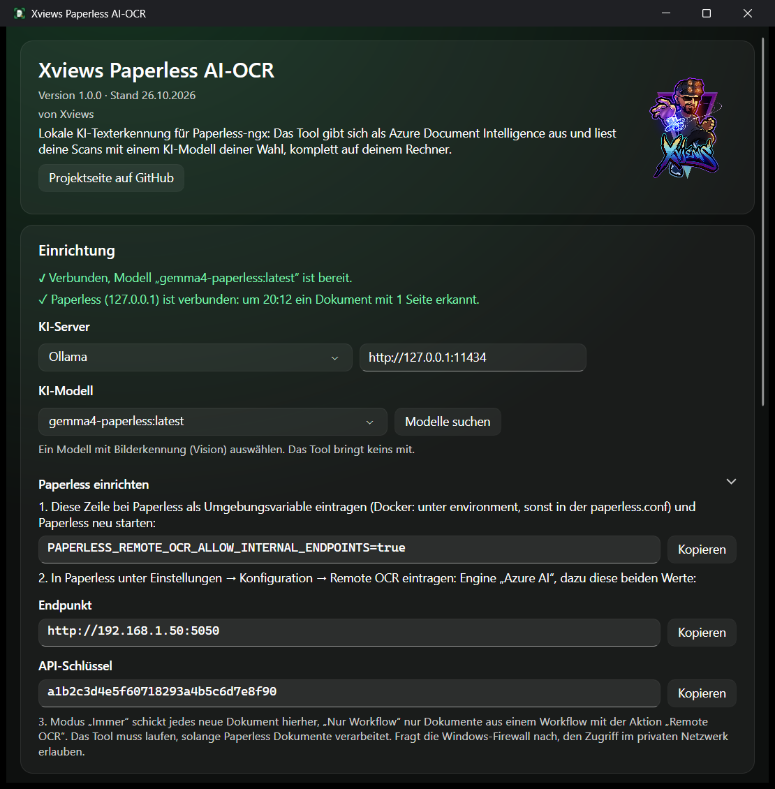
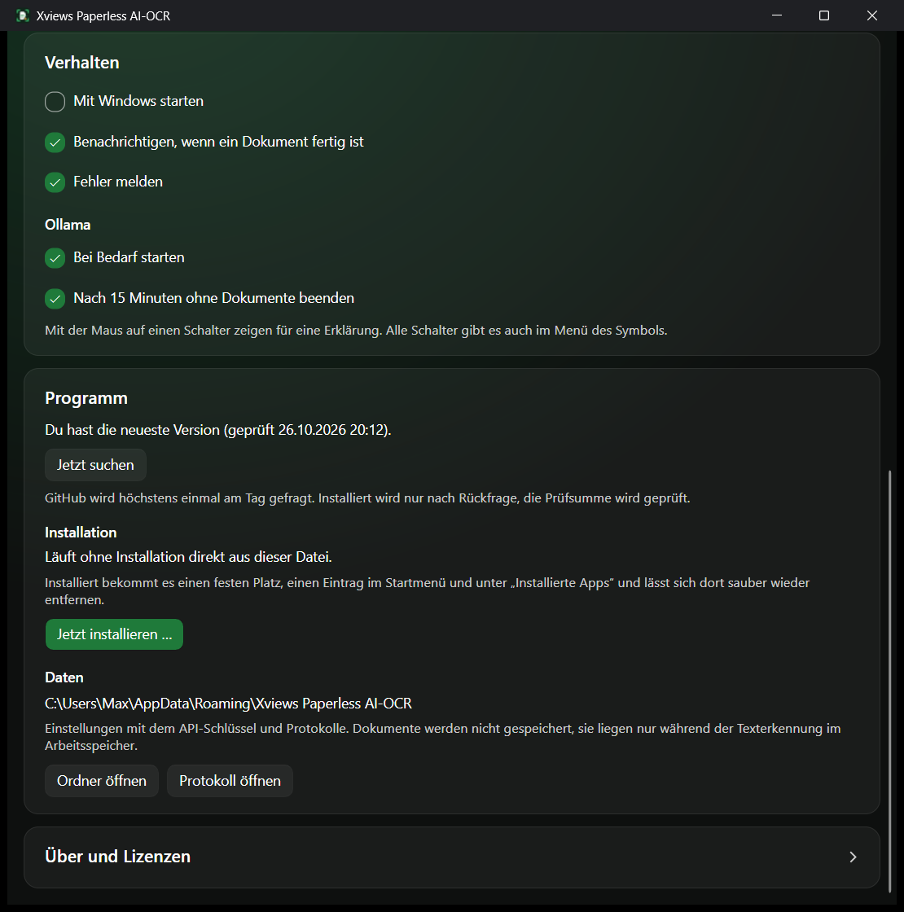
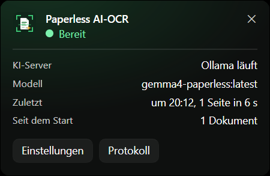

<p align="center">
  
</p>

<h1 align="center">Xviews Paperless AI-OCR</h1>

<p align="center">
  <a href="README.md">English</a> · <b>Deutsch</b>
</p>

<p align="center">
  <b>Paperless-ngx liest deine Scans mit KI statt mit Tesseract, komplett auf deinem Rechner.</b><br>
  Keine Cloud, keine Kosten pro Seite, kein Dokument verlässt dein Heimnetz.
</p>

<p align="center">
  <a href="https://github.com/xviews/xviews-paperless-ai-ocr/releases/latest/download/XviewsPaperlessAiOcr.exe"></a>
  <a href="#download"></a>
</p>

<p align="center">
  <a href="#so-gehts">So geht's</a> ·
  <a href="#funktionen">Funktionen</a> ·
  <a href="#download">Download</a> ·
  <a href="#wichtig">Wichtig</a> ·
  <a href="#lizenz--quellcode">Lizenz</a>
</p>

<p align="center"><sub>Privates Projekt ohne Verbindung zu Microsoft, Apple, Ollama, LM Studio oder dem Paperless-ngx-Projekt. „Microsoft“ und „Azure“ sind Marken der Microsoft Corporation, „Mac“ und „macOS“ Marken von Apple Inc.</sub></p>

---

Tesseract, die eingebaute Texterkennung von Paperless-ngx, stolpert über Tabellen, Umlaute, schiefe Scans und Briefköpfe. Paperless kann die Texterkennung zwar an einen externen Dienst abgeben, aber nur an Microsofts Cloud-Dienst Azure. **Dieses Tool gibt sich gegenüber Paperless als Azure aus** und lässt die Seiten stattdessen von einem KI-Modell deiner Wahl lesen, über [Ollama](https://ollama.com), [LM Studio](https://lmstudio.ai) oder einen anderen OpenAI-kompatiblen Server, auf deinem eigenen Windows-PC oder Mac. Paperless bekommt den Text und ein durchsuchbares PDF zurück, als käme beides aus der Cloud.

<p align="center">
  
</p>

## So geht's

| 1️⃣ KI-Server & Modell | 2️⃣ Tool starten | 3️⃣ Paperless einstellen |
|---|---|---|
| [Ollama](https://ollama.com/download) oder [LM Studio](https://lmstudio.ai) installieren und ein Modell mit Bilderkennung (Vision) laden. | Tool starten und installieren, dann KI-Server und Modell wählen. Das Info-Fenster zeigt, ob alles bereit ist, und alle Werte für Paperless zum Kopieren. | Eine Umgebungsvariable setzen, dann in Paperless unter *Konfiguration → Remote OCR* „Azure AI“, Endpunkt und API-Schlüssel eintragen. Fertig. |

<details>
<summary><b>Paperless einrichten, Schritt für Schritt</b></summary>

1. **Interne Adressen erlauben:** Paperless spricht von sich aus nur mit Adressen im Internet. Diese Umgebungsvariable erlaubt das Heimnetz:
   ```
   PAPERLESS_REMOTE_OCR_ALLOW_INTERNAL_ENDPOINTS=true
   ```
   - **Docker / docker-compose:** unter `environment:` des Paperless-Containers eintragen und den Container neu starten.
   - **Ohne Docker (direkt installiert):** in die Datei `paperless.conf` schreiben und Paperless neu starten.
   - **Home-Assistant-Add-on:** in die Datei `paperless.conf` im Konfigurationsordner des Add-ons schreiben (z. B. über das Samba-Add-on unter `addon_configs`) und das Add-on neu starten.
2. **Remote OCR einstellen:** In Paperless unter *Einstellungen → Konfiguration → Remote OCR*:
   - Engine: **Azure AI**
   - Endpunkt: steht im Info-Fenster, z. B. `http://192.168.1.20:5050`
   - API-Schlüssel: steht im Info-Fenster
   - Modus: **Immer** (jedes neue Dokument) oder **Nur Workflow** (nur Dokumente aus einem Workflow mit der Aktion „Remote OCR“)
3. **Firewall:** Beim ersten Zugriff fragt Windows bzw. macOS nach. Den Zugriff im **privaten Netzwerk** bzw. **eingehende Verbindungen** erlauben.

</details>

**Voraussetzungen:** ein Windows-PC oder Mac mit genug Grafikleistung im selben Netzwerk wie Paperless, Ollama, LM Studio oder ein anderer OpenAI-kompatibler KI-Server mit einem Modell mit Bilderkennung (Vision). Paperless-ngx mit Remote OCR (getestet mit 3.1.3).

## Funktionen

**Texterkennung**
- 🧠 **KI liest wie ein Mensch:** Tabellen, Umlaute, Briefköpfe, schiefe und verrauschte Scans. Das Modell schreibt nur ab und übersetzt oder korrigiert nichts.
- 🔎 **Durchsuchbares PDF:** Das Original bleibt unverändert, darüber liegt eine unsichtbare Textebene zum Suchen und Markieren.
- 🎛️ **KI-Server und Modell frei wählbar:** Ollama oder OpenAI-kompatibel (LM Studio, llama.cpp, vLLM, LocalAI …). Das Tool listet die Modelle mit Bilderkennung auf.
- 📄 **PDFs und Bilder,** auch mehrseitig. Die Seiten werden nacheinander gelesen, damit die Grafikkarte nicht überläuft.

**Bequem**
- 💤 **Ollama nur bei Bedarf:** startet automatisch, wenn Paperless ein Dokument schickt, und wird nach 15 Minuten Leerlauf wieder beendet. Beides einzeln abschaltbar. Ein von dir selbst gestartetes Ollama bleibt an. Andere Server startest du selbst.
- 🔔 **Benachrichtigung,** sobald ein Dokument fertig ist, und bei Fehlern mit verständlicher Ursache (Server nicht erreichbar, Modell fehlt, falscher API-Schlüssel …). Beides einzeln abschaltbar.
- 🔗 **Verbindung auf einen Blick:** Das Info-Fenster zeigt, ob der KI-Server bereit ist und wann Paperless sich zuletzt gemeldet hat. Schickt Paperless einen falschen API-Schlüssel, steht das direkt dort.
- 📦 **Installieren mit einem Klick:** unter Windows mit Startmenü-Eintrag und Eintrag unter „Installierte Apps“, am Mac im Ordner „Programme“. Kein Admin nötig. Deinstallieren wieder mit einem Klick, auf Wunsch samt Einstellungen. Ohne Installation läuft es auch.
- 🚀 **Automatisch starten,** auf Wunsch. Das Tool wartet dann unauffällig im Infobereich (Windows) bzw. in der Menüleiste (Mac).
- 📋 **Alle Werte zum Kopieren:** Endpunkt, API-Schlüssel und die Zeile für Paperless.
- ⬆️ **Updates mit einem Klick:** Das Tool meldet neue Versionen, lädt sie nach Rückfrage, prüft die Prüfsumme und startet neu.
- 🌍 **Deutsch oder Englisch:** Die App richtet sich nach der Systemsprache.

**Sicher**
- 🔐 **Eigener API-Schlüssel:** Beim ersten Start erzeugt das Tool einen zufälligen Schlüssel. Ohne ihn nimmt es keine Dokumente an.
- 🏠 **Bleibt im Heimnetz:** Dokumente liegen nur während der Erkennung im Arbeitsspeicher und werden nirgends gespeichert.
- 📖 **Offener Quellcode:** Jeder kann nachlesen, was das Tool mit den Dokumenten macht.

<table>
  <tr>
    <td width="50%"></td>
    <td width="50%"></td>
  </tr>
  <tr>
    <td align="center">Verhalten, Updates &amp; Installation</td>
    <td align="center">Statusfenster (Klick aufs Symbol)</td>
  </tr>
</table>

## Download

| Datei | Für | Hinweis |
|---|---|---|
| [`XviewsPaperlessAiOcr.exe`](https://github.com/xviews/xviews-paperless-ai-ocr/releases/latest/download/XviewsPaperlessAiOcr.exe) | Windows 10 / 11 (64 Bit) | Installer und Tool in einer Datei, ca. 68 MB |
| [`XviewsPaperlessAiOcr-mac-arm64.dmg`](https://github.com/xviews/xviews-paperless-ai-ocr/releases/latest/download/XviewsPaperlessAiOcr-mac-arm64.dmg) | Mac mit Apple-Chip (M1 und neuer), macOS 12 oder neuer | Öffnen, App in „Programme“ ziehen |
| [`XviewsPaperlessAiOcr-mac-x64.dmg`](https://github.com/xviews/xviews-paperless-ai-ocr/releases/latest/download/XviewsPaperlessAiOcr-mac-x64.dmg) | Mac mit Intel-Prozessor, macOS 12 oder neuer | Öffnen, App in „Programme“ ziehen |

**Voraussetzungen:** eine Grafikkarte bzw. ein Mac mit genug Speicher für das gewählte Modell. Für den Mac gibt es dieselbe App auch als ZIP-Datei. ➡️ Alle Versionen, ZIP-Dateien und Prüfsummen unter **[Releases](../../releases)**.

**Getestet mit:** Paperless-ngx 3.1.3 (Home-Assistant-Add-on), Ollama 0.40 (beide Modi) auf einer RTX 5090. Eine Seite dauert etwa 7 bis 20 Sekunden, beim ersten Dokument kommt das Laden des Modells dazu. Die Mac-Version ist neu.

**Sicherheit:** Die Prüfsumme (SHA-256) jeder Datei steht auf der Release-Seite. Unter Windows prüfst du sie mit `Get-FileHash .\XviewsPaperlessAiOcr.exe` in PowerShell, am Mac mit `shasum -a 256 XviewsPaperlessAiOcr-mac-arm64.dmg` im Terminal. Der Release-Text verlinkt außerdem das VirusTotal-Ergebnis.

<details>
<summary><b>Beim ersten Start unter Windows</b></summary>

- Meldet SmartScreen „Der Computer wurde durch Windows geschützt“, auf **„Weitere Informationen“** und dann auf **„Trotzdem ausführen“** klicken. Die EXE ist nicht signiert, weil ein Zertifikat Geld kostet.
- Das Tool fragt, ob es sich installieren soll. **„Installieren“** legt es nach `%LOCALAPPDATA%\Programs\Xviews Paperless AI-OCR` und ins Startmenü. **„Ohne Installation starten“** lässt es, wo es ist.
- Das Info-Fenster öffnet sich. Unter **KI-Modell** auf „Modelle suchen“ klicken, falls noch keins ausgewählt ist.
- Das Tool sitzt danach im Infobereich unten rechts. Ein Klick zeigt kurz, ob alles läuft und was zuletzt erkannt wurde, Rechtsklick öffnet das Menü. Zur Einrichtung geht es über „Einstellungen“ oder „Info und Einrichtung“.
- Fragt die Windows-Firewall nach, den Zugriff im **privaten Netzwerk** erlauben, sonst erreicht Paperless das Tool nicht.

</details>

<details>
<summary><b>Beim ersten Start am Mac</b></summary>

- Die DMG-Datei öffnen und die App auf *Applications* (Programme) ziehen. Mit der ZIP-Datei: per Doppelklick entpacken.
- Meldet macOS, dass die App nicht geöffnet werden kann, weil Apple sie nicht prüfen konnte: unter *Systemeinstellungen → Datenschutz & Sicherheit* unten auf **„Dennoch öffnen“** klicken. Die App ist nicht von Apple beglaubigt, weil das ein kostenpflichtiges Entwicklerkonto braucht.
- Das Tool fragt, ob es sich installieren soll. **„Installieren“** kopiert es in den Ordner *Programme* (ohne Schreibrecht dort nach *~/Programme*). **„Ohne Installation starten“** lässt es, wo es ist.
- Das Tool sitzt danach als Symbol oben in der Menüleiste, ohne Symbol im Dock. Ein Klick auf das Symbol öffnet das Menü.
- Fragt macOS, ob die App eingehende Verbindungen annehmen darf, auf **„Erlauben“** klicken, sonst erreicht Paperless das Tool nicht.

</details>

## Wichtig

- ⏳ **Das Tool muss laufen, solange Paperless Dokumente verarbeitet.** Läuft es nicht, bricht Paperless die Verarbeitung ab, und das Dokument muss erneut hochgeladen werden. Wer nur ab und zu scannt, nimmt den Modus „Nur Workflow“ oder startet das Tool vorher.
- 🤖 KI kann sich verlesen. Bei wichtigen Zahlen lohnt ein Blick ins Original.
- ⚠️ Nutzung auf eigene Verantwortung.
- 🚫 Das Tool sammelt keine Daten und schickt nichts an mich.

<details>
<summary><b>Wann das Tool ins Internet geht</b></summary>

- **Update-Suche:** Die öffentliche Release-Seite auf GitHub wird höchstens einmal am Tag abgefragt.
- Sonst spricht das Tool nur mit Paperless im Heimnetz und mit dem eingestellten KI-Server (normalerweise auf demselben Rechner). Modelle lädt der KI-Server selbst.

</details>

<details>
<summary><b>Wie es funktioniert</b></summary>

- Das Tool bildet die REST-Schnittstelle von *Azure AI Document Intelligence* nach (API-Version 2024-11-30, Modell `prebuilt-read`): `POST …:analyze` nimmt das Dokument an, `GET …/analyzeResults/{id}` liefert Status und Text, `GET …/analyzeResults/{id}/pdf` das durchsuchbare PDF.
- PDFs werden in Bilder umgewandelt (200 dpi), unter Windows mit Bordmitteln, am Mac mit PDFium, und Seite für Seite an den KI-Server geschickt (Ollama: `/api/chat` ohne „Denken“, sonst `/v1/chat/completions`; Temperatur 0).
- Das Ergebnis-PDF enthält die Originalseiten plus eine unsichtbare Textebene.
- Einstellungen und Protokolle liegen unter Windows in `%APPDATA%\Xviews Paperless AI-OCR`, am Mac in `~/Library/Application Support/Xviews Paperless AI-OCR`.

</details>

<details>
<summary><b>Deinstallieren</b></summary>

- **Windows:** über den Startmenü-Eintrag **„Paperless AI-OCR deinstallieren“**, unter *Einstellungen → Apps → Installierte Apps* oder im Tool unter *Info → Installation*. Entfernt werden Programm, Startmenü-Ordner, Autostart und der App-Eintrag.
- **Mac:** im Tool unter *Info → Installation*. Entfernt werden App und Autostart.

Einstellungen und Protokolle bleiben, außer du hakst „Einstellungen und Protokolle auch löschen“ an. Danach in Paperless Remote OCR wieder ausschalten.

</details>

## Lizenz & Quellcode

Xviews Paperless AI-OCR ist **freie Software unter der [MIT-Lizenz](LICENSE.txt)**. Du darfst das Tool nutzen, verändern und weitergeben, solange der Copyright-Hinweis erhalten bleibt. Die Lizenz gewährt keine Rechte am Namen „Xviews“ und am Xviews-Logo.

Enthaltene Komponenten: [PdfPig](https://github.com/UglyToad/PdfPig) 0.1.16 (Apache-Lizenz 2.0), [Avalonia](https://github.com/AvaloniaUI/Avalonia) 12.1.4 und [FluentAvalonia](https://github.com/amwx/FluentAvalonia) 3.1.0 (MIT-Lizenz), SkiaSharp und HarfBuzzSharp (MIT-Lizenz, mit Skia und HarfBuzz), .NET und ASP.NET Core (MIT-Lizenz) sowie in der Mac-Version [PDFium](https://github.com/bblanchon/pdfium-binaries) (BSD- und Apache-Lizenz 2.0). Die vollständigen Lizenztexte zeigt das Tool unter *Info → Lizenzen anzeigen*.

<details>
<summary><b>Selbst bauen</b></summary>

- [.NET 10 SDK](https://dotnet.microsoft.com/download) installieren.
- **Windows:** `src\build.cmd` ausführen. Die fertige `XviewsPaperlessAiOcr.exe` landet in `app\`.
- **Mac:** `src/build-mac.sh` auf einem Mac ausführen. ZIPs und DMGs (Apple-Chip und Intel) landen in `app/mac/`. Ohne Mac baut sie der GitHub-Workflow *Mac-Version* (`.github/workflows/mac.yml`), bei jedem Release automatisch.
- Dateien mit `.Windows.cs` bzw. `.Mac.cs` im Namen gehören nur zur jeweiligen Version, alles andere teilen sich beide.
- `test\` enthält einen Ende-zu-Ende-Test mit dem offiziellen Azure-SDK: `dotnet run --project test -- http://localhost:5050 <API-Schlüssel> <Ordner>`.

</details>

## Über den Namen

**X** steht für das Unbekannte, **views** fürs Sehen. Xviews heißt also: das Unbekannte sehen. Den Namen gibt es seit Counter-Strike 1.5, später stand er für meine HDR-Fotos im Netz, heute für meine Tools.

Auch ein Stapel Papier steckt voller Unbekannter: Was steht in der Tabelle auf Seite drei, und warum findet die Suche die Rechnung nicht? Paperless-ngx kann viel, aber seine Texterkennung kam mit meinen Scans nicht gut zurecht. Die gute KI-Erkennung gab es nur in der Cloud, und meine Dokumente wollte ich nicht aus der Hand geben. Also gibt sich jetzt ein kleines Tool als Cloud aus, und die KI läuft auf meinem eigenen Rechner: die **Xviews Paperless AI-OCR**.
