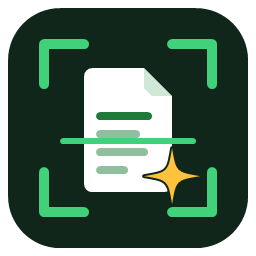
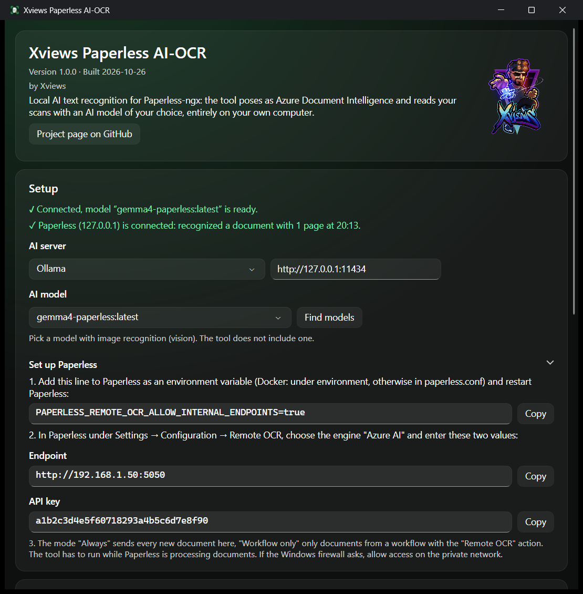
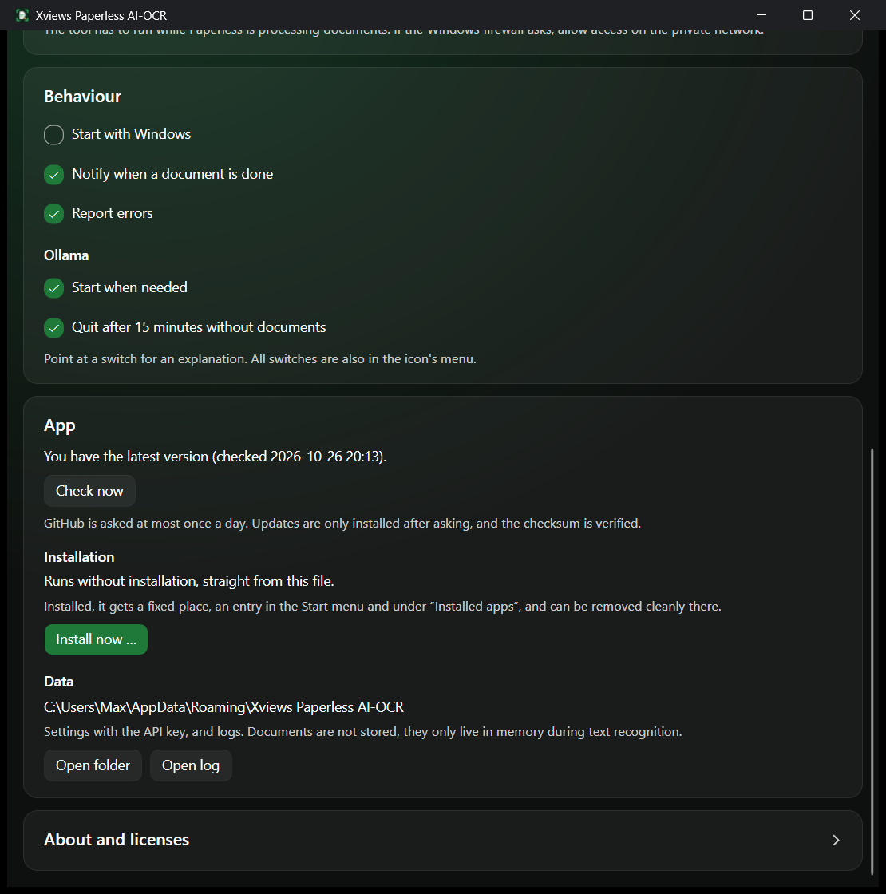
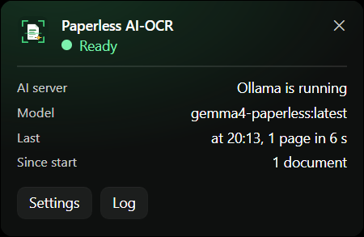

<p align="center">
  
</p>

<h1 align="center">Xviews Paperless AI-OCR</h1>

<p align="center">
  <b>English</b> · <a href="README.de.md">Deutsch</a>
</p>

<p align="center">
  <b>Paperless-ngx reads your scans with AI instead of Tesseract, entirely on your own computer.</b><br>
  No cloud, no cost per page, no document ever leaves your home network.
</p>

<p align="center">
  <a href="https://github.com/xviews/xviews-paperless-ai-ocr/releases/latest/download/XviewsPaperlessAiOcr.exe"></a>
  <a href="#download"></a>
</p>

<p align="center">
  <a href="#how-it-works">How it works</a> ·
  <a href="#features">Features</a> ·
  <a href="#download">Download</a> ·
  <a href="#good-to-know">Good to know</a> ·
  <a href="#license--source-code">License</a>
</p>

<p align="center"><sub>Private project, not affiliated with Microsoft, Apple, Ollama, LM Studio or the Paperless-ngx project. "Microsoft" and "Azure" are trademarks of Microsoft Corporation, "Mac" and "macOS" are trademarks of Apple Inc.</sub></p>

---

Tesseract, the built-in text recognition of Paperless-ngx, stumbles over tables, umlauts, skewed scans and letterheads. Paperless can hand text recognition to an external service, but only to Microsoft's cloud service Azure. **This tool pretends to be Azure** and has the pages read by an AI model of your choice instead, through [Ollama](https://ollama.com), [LM Studio](https://lmstudio.ai) or another OpenAI-compatible server, on your own Windows PC or Mac. Paperless gets the text and a searchable PDF back, as if both came from the cloud.

> **Language:** The app speaks English or German. It follows your system language: German on a German system, English everywhere else.

<p align="center">
  
</p>

## How it works

| 1️⃣ AI server & model | 2️⃣ Start the tool | 3️⃣ Set up Paperless |
|---|---|---|
| Install [Ollama](https://ollama.com/download) or [LM Studio](https://lmstudio.ai) and load a model with image recognition (vision). | Start and install the tool, then pick AI server and model. The info window shows whether everything is ready, plus all values for Paperless to copy. | Set one environment variable, then enter "Azure AI", endpoint and API key in Paperless under *Configuration → Remote OCR*. Done. |

<details>
<summary><b>Setting up Paperless, step by step</b></summary>

1. **Allow internal addresses:** By default Paperless only talks to addresses on the internet. This environment variable allows your home network:
   ```
   PAPERLESS_REMOTE_OCR_ALLOW_INTERNAL_ENDPOINTS=true
   ```
   - **Docker / docker-compose:** add it under `environment:` of the Paperless container and restart the container.
   - **Without Docker (installed directly):** add it to `paperless.conf` and restart Paperless.
   - **Home Assistant add-on:** add it to `paperless.conf` in the add-on's configuration folder (e.g. via the Samba add-on under `addon_configs`) and restart the add-on.
2. **Set up Remote OCR:** In Paperless under *Settings → Configuration → Remote OCR*:
   - Engine: **Azure AI**
   - Endpoint: shown in the info window, e.g. `http://192.168.1.20:5050`
   - API key: shown in the info window
   - Mode: **Always** (every new document) or **Workflow only** (only documents from a workflow with the "Remote OCR" action)
3. **Firewall:** On first access, Windows or macOS asks. Allow access on the **private network** or allow **incoming connections**.

</details>

**Requirements:** a Windows PC or Mac with enough graphics power on the same network as Paperless, Ollama, LM Studio or another OpenAI-compatible AI server with a vision model. Paperless-ngx with Remote OCR (tested with 3.1.3).

## Features

**Text recognition**
- 🧠 **AI reads like a human:** tables, umlauts, letterheads, skewed and noisy scans. The model only transcribes and never translates or corrects.
- 🔎 **Searchable PDF:** the original stays untouched, with an invisible text layer on top for searching and selecting.
- 🎛️ **Any AI server and model:** Ollama or OpenAI-compatible (LM Studio, llama.cpp, vLLM, LocalAI …). The tool lists the models that can read images.
- 📄 **PDFs and images,** multi-page too. Pages are read one after another so the graphics card does not run out of memory.

**Convenient**
- 💤 **Ollama only when needed:** starts automatically when Paperless sends a document and quits after 15 minutes of idle time. Both can be switched off. An Ollama you started yourself stays on. Other servers you start yourself.
- 🔔 **Notifications** when a document is done, and on errors with a clear cause (server unreachable, model missing, wrong API key …). Both can be switched off.
- 🔗 **Connection at a glance:** the info window shows whether the AI server is ready and when Paperless last checked in. If Paperless sends a wrong API key, it says so right there.
- 📦 **One-click install:** on Windows with Start menu entry and an entry under "Installed apps", on the Mac in the Applications folder. No admin rights needed. Uninstall with one click, optionally including settings. It also runs without installing.
- 🚀 **Start automatically,** if you like. The tool then waits quietly in the notification area (Windows) or the menu bar (Mac).
- 📋 **Every value ready to copy:** endpoint, API key and the line for Paperless.
- ⬆️ **One-click updates:** the tool reports new versions, downloads them after asking, checks the checksum and restarts.
- 🌍 **English or German:** the app follows your system language.

**Safe**
- 🔐 **Its own API key:** on first start the tool creates a random key. Without it, no documents are accepted.
- 🏠 **Stays in your home network:** documents only live in memory during recognition and are never stored.
- 📖 **Open source:** anyone can read what the tool does with the documents.

<table>
  <tr>
    <td width="50%"></td>
    <td width="50%"></td>
  </tr>
  <tr>
    <td align="center">Behaviour, updates &amp; installation</td>
    <td align="center">Status window (click on the icon)</td>
  </tr>
</table>

## Download

| System | Download | Note |
|---|---|---|
| **Windows** 10 / 11 (64-bit) | [](https://github.com/xviews/xviews-paperless-ai-ocr/releases/latest/download/XviewsPaperlessAiOcr.exe) | Installer and tool in one file, about 68 MB |
| **Mac** with Apple chip (M1 and later), macOS 12 or later | [](https://github.com/xviews/xviews-paperless-ai-ocr/releases/latest/download/XviewsPaperlessAiOcr-mac-arm64.dmg) [](https://github.com/xviews/xviews-paperless-ai-ocr/releases/latest/download/XviewsPaperlessAiOcr-mac-arm64.zip) | DMG or ZIP, same app |
| **Mac** with Intel processor, macOS 12 or later | [](https://github.com/xviews/xviews-paperless-ai-ocr/releases/latest/download/XviewsPaperlessAiOcr-mac-x64.dmg) [](https://github.com/xviews/xviews-paperless-ai-ocr/releases/latest/download/XviewsPaperlessAiOcr-mac-x64.zip) | DMG or ZIP, same app |

**Mac: DMG or ZIP?** Both contain the same app. The DMG opens a window: drag the app onto *Applications*. The ZIP unpacks with a double-click; the tool then offers to move itself into *Applications*.

**Requirements:** a graphics card or Mac with enough memory for the chosen model. ➡️ All versions and checksums under **[Releases](../../releases)**.

**Tested with:** Paperless-ngx 3.1.3 (Home Assistant add-on), Ollama 0.40 (both modes) on an RTX 5090. One page takes about 7 to 20 seconds, plus loading the model for the first document. The Mac version is new.

**Security:** the checksum (SHA-256) of every file is shown on the release page. On Windows check it with `Get-FileHash .\XviewsPaperlessAiOcr.exe` in PowerShell, on the Mac with `shasum -a 256 XviewsPaperlessAiOcr-mac-arm64.dmg` in Terminal. The release notes also link the VirusTotal result.

<details>
<summary><b>First start on Windows</b></summary>

- If SmartScreen says "Windows protected your PC", click **"More info"** and then **"Run anyway"**. The EXE is not signed because a certificate costs money.
- The tool asks whether to install itself. **"Install"** puts it in `%LOCALAPPDATA%\Programs\Xviews Paperless AI-OCR` and the Start menu. **"Start without installing"** leaves it where it is.
- The info window opens. Under **KI-Modell** (AI model) click "Modelle suchen" (Find models) if none is selected yet.
- The tool then sits in the notification area at the bottom right. A click shows at a glance whether everything is running and what was recognized last, a right-click opens the menu. Setup is under "Settings" or "Info and setup".
- If the Windows firewall asks, allow access on the **private network**, otherwise Paperless cannot reach the tool.

</details>

<details>
<summary><b>First start on the Mac</b></summary>

- Open the dmg file and drag the app onto *Applications*. With the zip file: double-click to unpack it.
- If macOS says the app cannot be opened because Apple cannot check it: go to *System Settings → Privacy & Security* and click **"Open Anyway"** at the bottom. The app is not notarized by Apple because that requires a paid developer account.
- The tool asks whether to install itself. **"Install"** copies it to the *Applications* folder (to *~/Applications* if you cannot write there). **"Start without installing"** leaves it where it is.
- The tool then sits as an icon in the menu bar at the top, without a Dock icon. A click on the icon opens the menu.
- If macOS asks whether the app may accept incoming connections, click **"Allow"**, otherwise Paperless cannot reach the tool.

</details>

## Good to know

- ⏳ **The tool has to run while Paperless is processing documents.** If it is not running, Paperless aborts processing and the document has to be uploaded again. If you only scan now and then, use the "Workflow only" mode or start the tool beforehand.
- 🤖 AI can misread. For important numbers, a look at the original is worth it.
- ⚠️ Use at your own risk.
- 🚫 The tool collects no data and sends nothing to me.

<details>
<summary><b>When the tool goes online</b></summary>

- **Update check:** the public release page on GitHub is queried at most once a day.
- Otherwise the tool only talks to Paperless in your home network and to the configured AI server (usually on the same computer). Models are downloaded by the AI server itself.

</details>

<details>
<summary><b>Under the hood</b></summary>

- The tool imitates the REST interface of *Azure AI Document Intelligence* (API version 2024-11-30, model `prebuilt-read`): `POST …:analyze` accepts the document, `GET …/analyzeResults/{id}` returns status and text, `GET …/analyzeResults/{id}/pdf` the searchable PDF.
- PDFs are turned into images (200 dpi), on Windows with built-in system functions, on the Mac with PDFium, and sent to the AI server page by page (Ollama: `/api/chat` without "thinking", otherwise `/v1/chat/completions`; temperature 0). If the model gets stuck repeating itself with Ollama (e.g. on dashed lines), the tool reads the page once more with a little leeway; if that fails too, only that page stays without text and the notification says so.
- The resulting PDF contains the original pages plus an invisible text layer.
- Settings and logs are stored in `%APPDATA%\Xviews Paperless AI-OCR` on Windows and in `~/Library/Application Support/Xviews Paperless AI-OCR` on the Mac.

</details>

<details>
<summary><b>Uninstalling</b></summary>

- **Windows:** via the Start menu entry **"Paperless AI-OCR deinstallieren"**, under *Settings → Apps → Installed apps* or in the tool under *Info → Installation*. This removes the program, Start menu folder, autostart and the app entry.
- **Mac:** in the tool under *Info → Installation*. This removes the app and autostart.

Settings and logs stay unless you tick "Einstellungen und Protokolle auch löschen" (also delete settings and logs). Afterwards switch Remote OCR off again in Paperless.

</details>

## License & source code

Xviews Paperless AI-OCR is **free software under the [MIT license](LICENSE.txt)**. You may use, modify and share the tool as long as the copyright notice is kept. The license grants no rights to the name "Xviews" or the Xviews logo.

Included components: [PdfPig](https://github.com/UglyToad/PdfPig) 0.1.16 (Apache License 2.0), [Avalonia](https://github.com/AvaloniaUI/Avalonia) 12.1.4 and [FluentAvalonia](https://github.com/amwx/FluentAvalonia) 3.1.0 (MIT license), SkiaSharp and HarfBuzzSharp (MIT license, with Skia and HarfBuzz), .NET and ASP.NET Core (MIT license) and, in the Mac version, [PDFium](https://github.com/bblanchon/pdfium-binaries) (BSD and Apache License 2.0). The tool shows the full license texts under *Info → Lizenzen anzeigen*.

<details>
<summary><b>Building it yourself</b></summary>

- Install the [.NET 10 SDK](https://dotnet.microsoft.com/download).
- **Windows:** run `src\build.cmd`. The finished `XviewsPaperlessAiOcr.exe` ends up in `app\`.
- **Mac:** run `src/build-mac.sh` on a Mac. The zips and dmgs (Apple chip and Intel) end up in `app/mac/`. Without a Mac, the GitHub workflow *Mac-Version* (`.github/workflows/mac.yml`) builds them, automatically for every release.
- Files with `.Windows.cs` or `.Mac.cs` in their name belong to that version only; everything else is shared.
- `test\` contains an end-to-end test with the official Azure SDK: `dotnet run --project test -- http://localhost:5050 <API key> <folder>`.

</details>

## About the name

**X** stands for the unknown, **views** for seeing. So Xviews means: seeing the unknown. The name goes back to Counter-Strike 1.5, later it stood for my HDR photos online, and today for my tools.

A stack of paper is full of unknowns too: what is in the table on page three, and why can't search find the invoice? Paperless-ngx can do a lot, but its text recognition did not cope well with my scans. Good AI recognition was only available in the cloud, and I did not want to let my documents out of my hands. So now a small tool pretends to be the cloud, and the AI runs on my own computer: **Xviews Paperless AI-OCR**.
